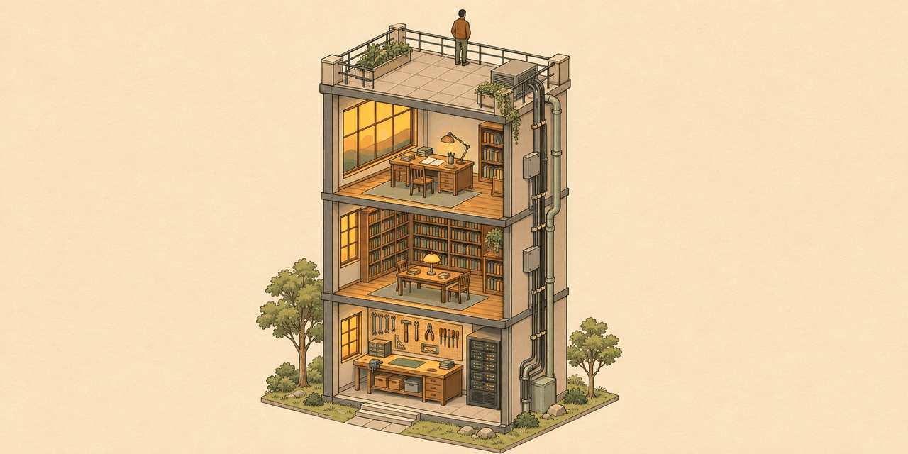

Hi, I'm Pascal. I build command-line tools and agent skills that humans and AI agents run equally well.

Start with these:

- **[nicely](https://github.com/pascalandy/nicely)**: a curated CLI toolbox for humans and agents. Install it with `brew install pascalandy/tap/ncly`
- **[skills](https://github.com/pascalandy/skills)**: agent skills you use by pasting one sentence into any AI chat. [Guide en français](https://github.com/pascalandy/skills/tree/main/docs/guide-fr-ca)
- **[pascalandy-blog-paper](https://github.com/pascalandy/pascalandy-blog-paper)**: the source of my blog, notes on building, in French. [Read the blog](https://pascalandy.com/blog/)
